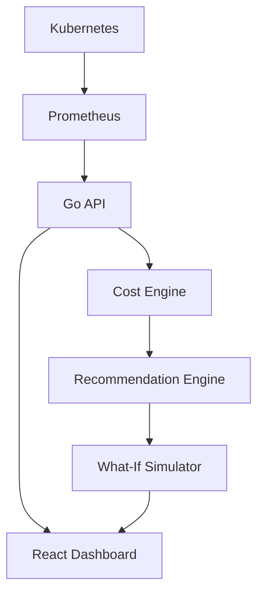

# AetherOps

**AI Infrastructure Cost Optimization Platform**

---

## 🛑 Problem

Cloud-native infrastructure wastes billions of dollars annually through idle resources, inefficient scheduling, and over-provisioned nodes. Engineering teams struggle to identify exact areas of waste, and often lack the confidence to implement aggressive cost-saving measures for fear of impacting production reliability.

## 💡 Solution

AetherOps is a proactive AI Cost Engine that analyzes Kubernetes clusters, estimates infrastructure costs, identifies waste, and explains exactly *why* a recommendation is made. Most importantly, AetherOps provides a **What-If Simulator** that predicts the financial and operational impact of an optimization *before* any changes are applied, giving engineers the trust and confidence needed to act.

---

## ✨ Features

- **✓ Kubernetes Monitoring:** Direct integration with cluster states.
- **✓ Prometheus Integration:** Ingests live metrics directly from your monitoring stack.
- **✓ Cost Engine:** Transforms raw infrastructure metrics (CPU/Mem) into business-readable cost estimates.
- **✓ Explainable Recommendations:** Deterministic, metric-backed explanations for every AI recommendation (No hallucinated reasoning).
- **✓ What-If Simulator:** Predicts cost savings, cluster CPU/Memory impact, and risk levels for multiple execution options (Remove, Resize, Bin Pack) prior to execution.
- **✓ Cost Timeline:** Annotates cost fluctuations with observed, factual cluster events.
- **✓ Drill-down Cost Analysis:** (In Development) Break down costs from the Cluster level down to the Namespace and Workload.

---

## 🏗 Architecture



## 🛠 Tech Stack

- **Backend:** Go, Gin
- **Frontend:** Next.js, React, TypeScript, Tailwind CSS
- **Data & Monitoring:** Prometheus, Kubernetes, SQLite
- **Architecture:** Decoupled Providers & Simulation Engine

---

## 🚀 Local Setup

### Prerequisites
- Go 1.21+
- Node.js 18+
- (Optional) Local Kubernetes cluster like `kind` or `minikube` running Prometheus.

### 1. Run the Backend
```bash
cd backend
go mod tidy
# Start the Go server on port 8080
go run cmd/server/main.go
```
*Note: The backend defaults to a mock data provider if Prometheus is not detected in your configuration.*

### 2. Run the Frontend
```bash
cd frontend
npm install
# Start the Next.js dev server on port 3000
npm run dev
```

Visit `http://localhost:3000` to view the AetherOps dashboard.

---

## 📸 Screenshots

*(To be added after initial user testing)*

- **Executive Dashboard:** Overview of cluster health and cost metrics.
- **Optimization Center:** List of active recommendations.
- **What-If Simulator:** Visual diff of projected savings and risks.

---

## 🛣 Roadmap

- **Phase 1:** API & Dashboard Foundation ✅
- **Phase 2:** Prometheus Metrics Integration ✅
- **Phase 3:** Cost Engine & Recommendation Engine ✅
- **Phase 4:** Explainability & Trust ✅
- **Phase 5:** What-If Simulator ✅
- **Phase 6:** Optimization Score & Recommendation Lifecycle 🔄
- **Phase 7:** Safe Kubernetes Actions (YAML Diff -> Apply -> Confirm) 📅
- **Phase 8:** AI Assistant Chat 📅
- **Phase 9:** Multi-Cluster & Multi-Cloud Support 📅
