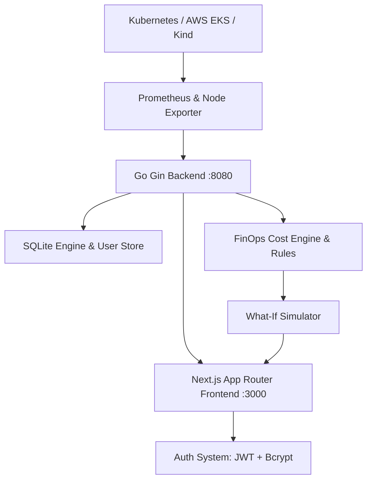

# AetherOps: Autonomous Multi-Cloud AI Infrastructure & Kubernetes Platform

**Autonomous Multi-Cloud Kubernetes & AI Infrastructure Operations, FinOps Optimization Engine, and Self-Healing Automation**

---

## 🛑 Problem

Modern cloud engineering teams spend countless hours wrestling with fragmented tooling: bouncing across AWS Management Consoles, Grafana metrics dashboards, kubectl terminals, Datadog alerts, and manual Terraform runs. Furthermore, multi-cloud and GPU clusters waste enormous sums on unmanaged idle resources, over-provisioned nodes, and silent CrashLoopBackOff container failures without automated remediation.

## 💡 Solution

AetherOps provides a unified, autonomous command platform for multi-cloud Kubernetes clusters and GPU infrastructure. It continuously monitors live node telemetry, provides automated rightsizing with explainable ROI rationale, features a safe **What-If Simulation Sandbox**, and autonomously handles cluster healing, rolling restarts, and FinOps audits with end-to-end user authentication.

---

## ✨ Core Platform Modules

- **🔐 End-to-End Authentication & Security:**
  - Secure User Registration (Sign Up) with strong password enforcement, unique email validation, and bcrypt password hashing.
  - Secure Login (Sign In) with JWT session cookies, rate-limiting brute-force protection (5 attempts/min), and Remember-Me persistence.
  - Password Reset with time-sensitive crypto tokens.
  - Navigation controls providing one-click "Back to Home" navigation from all authentication screens.
  - User session context eliminating all mock placeholder profiles.

- **🌐 Zero-Mock Live Infrastructure Telemetry:**
  - Full dynamic binding between frontend views and backend REST APIs at `http://localhost:8080/api/v1/...`.
  - Live hardware metrics: GPU saturation, VRAM usage, node CPU load, and cluster health streaming directly from the Go backend.
  - Real-time cache busting (`cache: no-store` with timestamp parameters) ensuring the **Refresh** button always fetches the latest cluster states synchronously.

- **📊 Modern Linear-Inspired Dashboard:**
  - High-velocity dark aesthetic styled in **Muted Sage Grey (`#8EA396`)**, **Warm Cream Beige (`#F5F0E6`)**, and **Deep Burgundy (`#8B1D41`)**.
  - Interactive "Start Building" direct route to authentication and personalized dashboard onboarding.
  - Dynamic run-rate trend graphs and live FinOps scores calculated directly from monitored workload snapshots.

- **🚀 Kubernetes Fleet Management & Self-Healing:**
  - Cluster Fleet Manager for AWS EKS and local Kind environments.
  - Real-time application rollout, canary deployment generator, and declarative Terraform blueprint views.
  - Autonomous Horizontal Pod Autoscaling (HPA) policies and crash-loop isolation.

- **🧪 What-If FinOps Simulator:**
  - Interactive sandbox allowing SREs to model Spot/Preemptible instance migration and node buffer headroom against the live cluster baseline before applying changes.

- **📄 Automated FinOps Reports:**
  - Instant downloadable CSV reports (`/api/v1/reports/export/csv`) covering costs, active hardware inventory, and AI recommendation rationale.

---

## 🏗 Architecture



---

## 🛠 Tech Stack

- **Backend:** Go 1.23+, Gin Web Framework, SQLite (Modernc pure-Go driver), Bcrypt, JWT (golang-jwt)
- **Frontend:** Next.js 16 (App Router), React 19, TypeScript, Vanilla CSS design system (Linear-inspired)
- **Data & Telemetry:** Recharts, Prometheus Metrics, NVML GPU bindings
- **Palette Tokens:** Muted Sage Grey (`#8EA396`), Warm Cream Beige (`#F5F0E6`), Deep Burgundy (`#8B1D41`)

---

## 🚀 Running Locally

### 1. Prerequisites
- **Go 1.21+**
- **Node.js 18+** & `npm`

### 2. Start the Backend API (:8080)
```bash
cd backend
go run cmd/server/main.go
```
*The backend automatically initializes `cost.db` with user tables and real infrastructure snapshots.*

### 3. Start the Frontend (:3000)
```bash
cd frontend
npm run build
npm run start
```
Open **`http://localhost:3000`** in your browser.

---

## 🛣 Milestones & Recent Updates

- **Authentication System Complete:** Sign In, Sign Up, Sign Out, and Password Reset workflows verified with bcrypt and JWT tokens.
- **Removed View Telemetry CTA:** Home page streamlined to high-impact "Start building" CTA linking directly to sign up.
- **Eliminated Mock Data:** Removed mock arrays (`telemetryData`, `insights`, `John Doe`) across all dashboard views, monitoring screens, and sidebars.
- **Working Dynamic Refresh:** Integrated timestamped cache-busting to ensure instant data reload across clusters, nodes, and workloads.
- **Seamless Navigation:** Added dedicated "Back to Home" navigation options across all authentication pages.
